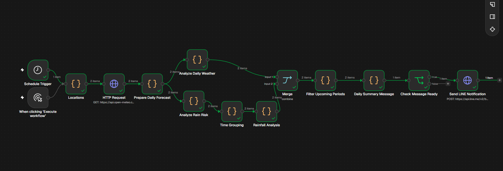
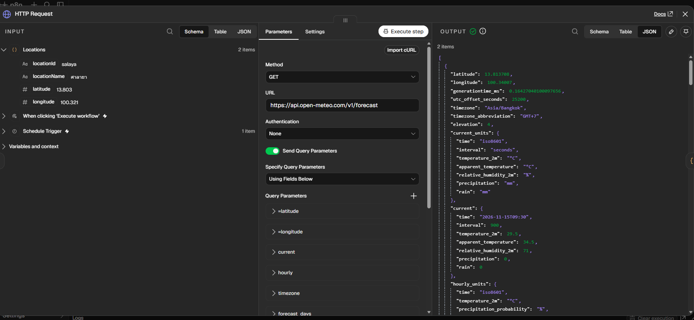
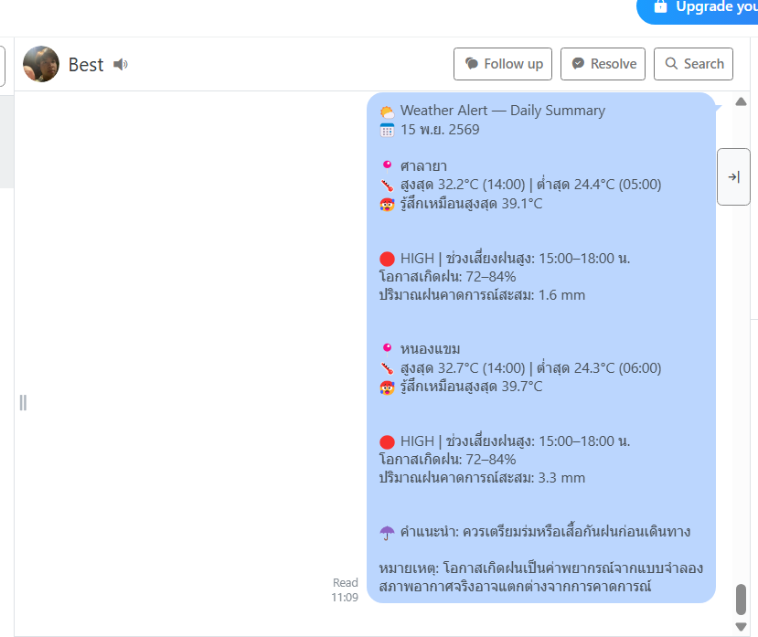

# Weather Alert Bot

[English](README.md) | [ภาษาไทย](README.th.md)

**Multi-location Weather Forecasting & LINE Notification Automation**

Weather Alert Bot is an automated weather forecasting and notification system built with n8n, Open-Meteo API, and LINE Official Account.

The system retrieves weather forecast data for Nong Khaem and Salaya, analyzes temperature and rainfall risks, and delivers a consolidated Daily Weather Summary through LINE.

Its goal is to reduce manual weather checking and help users prepare for daily travel.

---

## Problem Statement

Users who regularly travel between Nong Khaem and Mahidol University's Salaya campus need to check weather conditions in multiple locations separately.

They must manually compare rainfall probability and expected rain periods before deciding how to prepare for their journey.

Weather conditions may also differ between nearby locations and along the travel route.

This project addresses these problems by automating weather data collection, analysis, and LINE notifications.

## Key Features

- **Multi-location Forecasting:** Retrieves weather forecast data for Nong Khaem and Salaya.
- **Daily Weather Analysis:** Summarizes daily maximum and minimum temperatures and maximum feels-like temperature.
- **Rain Risk Classification:** Classifies rainfall probability into five predefined risk levels.
- **Rain Period Grouping:** Groups consecutive WATCH and HIGH risk hours into time periods.
- **Precipitation Analysis:** Calculates accumulated forecast precipitation for each rainy period.
- **Upcoming Period Filtering:** Removes expired forecast hours and weather periods.
- **Daily Summary Generation:** Combines weather information from both locations into one concise message.
- **LINE Notification:** Sends the daily weather summary through LINE Official Account.

## Rain Risk Classification

The system classifies hourly rainfall probability into five levels.

| Risk Level | Probability | Description |
|---|---:|---|
| NONE | 0% | No forecast rainfall probability |
| LOW | 1–29% | Low probability |
| MODERATE | 30–59% | Moderate probability |
| WATCH | 60–69% | Rain monitoring level |
| HIGH | 70–100% | High rain risk |

Only WATCH and HIGH are grouped into detailed rain alert periods.

Each alert period includes:
- Expected time range
- Minimum and maximum rainfall probability
- Accumulated forecast precipitation

LOW and MODERATE are not included in detailed alert-period grouping, helping keep notifications concise.

## Workflow Overview

The automation workflow is built with n8n.

```text
Schedule Trigger / Manual Trigger
              |
              v
          Locations
              |
              v
         HTTP Request
              |
              v
     Prepare Daily Forecast
              |
        +-----+-----+
        |           |
        v           v
 Analyze Daily   Analyze Rain
   Weather          Risk
                     |
                     v
                Time Grouping
                     |
                     v
               Rainfall Analysis
        |            |
        +-----+------+
              |
              v
            Merge
              |
              v
     Filter Upcoming Periods
              |
              v
    Daily Summary Message
              |
              v
      Check Message Ready
              |
              v
     Send LINE Notification
```

The workflow supports both scheduled execution and manual execution for testing.

## Technology Stack

| Technology | Purpose |
|---|---|
| n8n | Workflow automation and data processing |
| Open-Meteo API | Weather forecast data source |
| LINE Official Account | Weather notification channel |
| LINE Messaging API | Message delivery |
| JavaScript | Weather analysis and business logic |

## Project Structure

```text
weather-alert-bot/
|
|-- README.md
|-- README.th.md
|
|-- docs/
|   |-- Project Charter - Weather Alert Bot.pdf
|   |-- Requirements - Weather Alert Bot.pdf
|
|-- screenshots/
|   |-- workflow-overview.png
|   |-- node-httprequest.png
|   |-- line-notification.png
|
|-- src/
|   |-- locations.js
|   |-- prepare-daily-forecast.js
|   |-- analyze-daily-weather.js
|   |-- analyze-rain-risk.js
|   |-- time-grouping.js
|   |-- rainfall-analysis.js
|   |-- filter-upcoming-periods.js
|   |-- daily-summary-message.js
|
|-- workflows/
|   |-- weather-alert-bot-public.json
|
|-- .gitignore
```

## Screenshots

### Workflow Overview



### Open-Meteo API Integration



### LINE Weather Notification



## Getting Started

### Prerequisites

- An n8n instance
- A LINE Official Account
- A LINE Messaging API channel with a valid Channel Access Token

### 1. Import the Workflow

Import the following file into n8n:

```text
workflows/weather-alert-bot-public.json
```

### 2. Configure LINE Credentials

Create a Bearer Auth credential in n8n using your LINE Messaging API Channel Access Token.

Assign the credential to the `Send LINE Notification` node.

**Important:** Do not place API tokens or credentials directly in the workflow JSON or source code.

### 3. Review Workflow Settings

Check the following configurations:

- Location coordinates in the `Locations` node.
- Thailand timezone (`Asia/Bangkok`).
- Scheduled notification time.
- LINE credential assignment.

The provided workflow is configured for the initial two locations and a 07:00 Thailand-time schedule.

### 4. Execute the Workflow

Run the workflow manually to verify data retrieval, weather analysis, and LINE message delivery.

Review the execution output before activating scheduled execution.

## Documentation

Project analysis and requirements documents:

- [Project Charter](docs/Project%20Charter%20%E2%80%94%20Weather%20Alert%20Bot.pdf)
- [Requirements Document](docs/Requirements%20%E2%80%94%20Weather%20Alert%20Bot.pdf)

## Limitations

- Currently supports two predefined locations: Nong Khaem and Salaya.
- Does not provide weather analysis for the entire travel route.
- Forecast information may differ from actual weather conditions.
- Depends on Open-Meteo API and external services.
- Users cannot customize locations or notification schedules through LINE.
- On-demand weather queries and user personalization are not yet implemented.

## Project Status

**Implemented**
- Multi-location weather data retrieval.
- Daily and hourly weather analysis.
- Five-level rainfall risk classification.
- WATCH and HIGH risk-period grouping.
- Daily summary generation.
- LINE notification workflow.

**Manually Tested**
- Workflow execution.
- Weather summary generation.
- LINE message delivery.

**Pending Validation**
- Scheduled production execution.
- 7–14 day real-world user validation.
- Further testing of forecast handling and exceptional scenarios.

## Future Scope

- On-demand weather queries through LINE.
- Route-based weather analysis.
- User-defined locations.
- Customizable notification schedules.
- Multi-user support and personalization.
- Calendar integration.

---

**Weather Alert Bot**
A workflow automation project focused on practical weather awareness and travel preparation.
