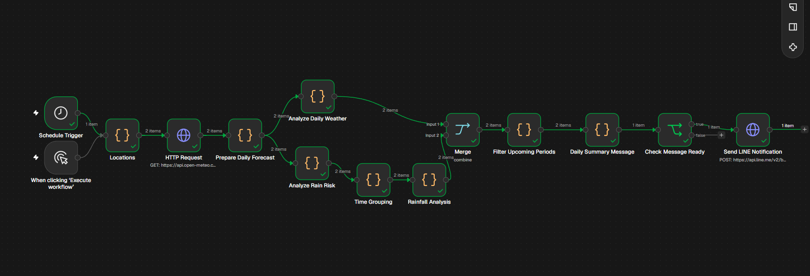
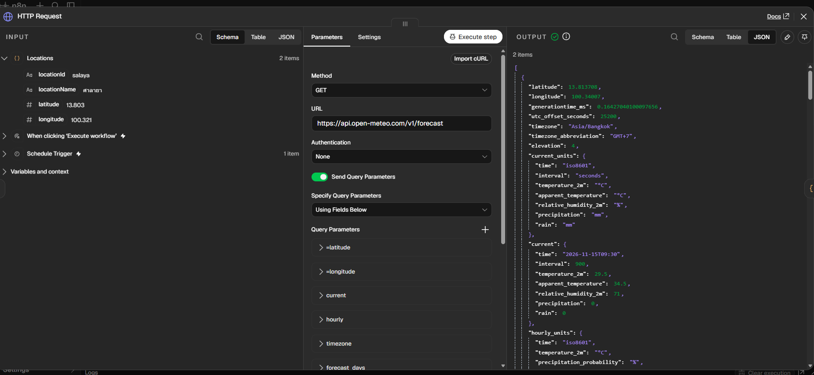
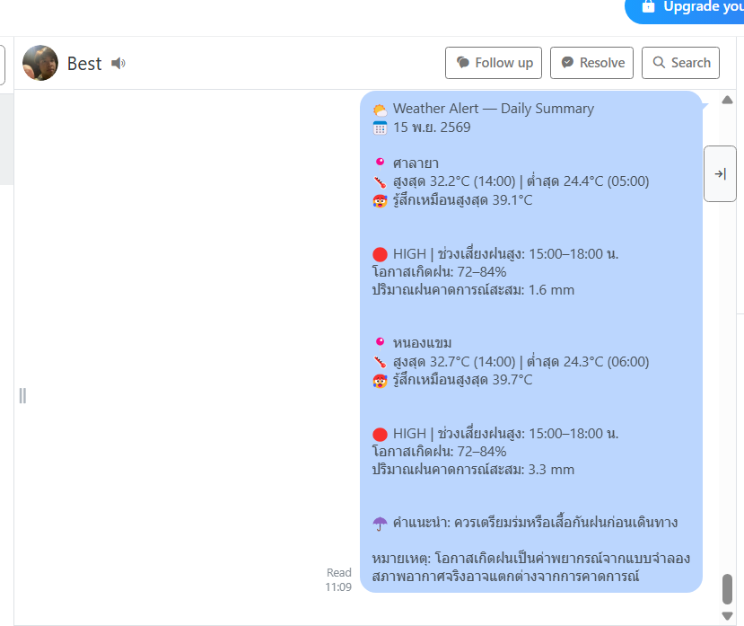

# Weather Alert Bot

[English](README.md) | [ภาษาไทย](README.th.md)

**ระบบพยากรณ์อากาศหลายพื้นที่และแจ้งเตือนผ่าน LINE โดยอัตโนมัติ**

Weather Alert Bot เป็นระบบสรุปและแจ้งเตือนข้อมูลพยากรณ์อากาศอัตโนมัติ พัฒนาด้วย n8n, Open-Meteo API และ LINE Official Account

ระบบรวบรวมข้อมูลพยากรณ์อากาศของหนองแขมและศาลายา วิเคราะห์อุณหภูมิและความเสี่ยงจากฝน ก่อนจัดทำรายงานสภาพอากาศประจำวัน (Daily Weather Summary) และส่งให้ผู้ใช้ผ่าน LINE

มีเป้าหมายเพื่อลดขั้นตอนการตรวจสอบสภาพอากาศด้วยตนเอง และช่วยให้ผู้ใช้เตรียมความพร้อมก่อนเดินทางในแต่ละวัน

---

## Problem Statement

ผู้ใช้ที่เดินทางระหว่างหนองแขมและมหาวิทยาลัยมหิดล ศาลายาเป็นประจำ จำเป็นต้องตรวจสอบข้อมูลสภาพอากาศจากหลายพื้นที่แยกจากกัน

ผู้ใช้ต้องเปรียบเทียบโอกาสเกิดฝนและช่วงเวลาที่คาดว่าจะมีฝนด้วยตนเองก่อนตัดสินใจเตรียมตัวสำหรับการเดินทาง

นอกจากนี้ สภาพอากาศในแต่ละพื้นที่อาจแตกต่างกัน แม้จะเป็นพื้นที่ที่อยู่ใกล้เคียงกัน และสภาพอากาศระหว่างเส้นทางอาจแตกต่างจากบริเวณต้นทางและปลายทาง

โครงการนี้จึงนำระบบอัตโนมัติมาช่วยรวบรวม วิเคราะห์ และส่งข้อมูลพยากรณ์อากาศผ่าน LINE เพื่อลดภาระในการตรวจสอบข้อมูลด้วยตนเอง

## Key Features

- **Multi-location Forecasting:** ดึงข้อมูลพยากรณ์อากาศของหนองแขมและศาลายา
- **Daily Weather Analysis:** วิเคราะห์อุณหภูมิสูงสุด ต่ำสุด และอุณหภูมิที่รู้สึกได้สูงสุด
- **Rain Risk Classification:** จำแนกโอกาสเกิดฝนออกเป็น 5 ระดับ
- **Rain Period Grouping:** รวมชั่วโมงที่มีความเสี่ยง WATCH และ HIGH ซึ่งต่อเนื่องกันเป็นช่วงเวลา
- **Precipitation Analysis:** คำนวณปริมาณฝนคาดการณ์สะสมของแต่ละช่วง
- **Upcoming Period Filtering:** กรองชั่วโมงพยากรณ์และช่วงเวลาที่ผ่านไปแล้ว
- **Daily Summary Generation:** รวมข้อมูลสภาพอากาศของทั้งสองพื้นที่เป็นข้อความเดียว
- **LINE Notification:** ส่งรายงานผ่าน LINE Official Account

## Rain Risk Classification

ระบบจำแนกโอกาสเกิดฝนรายชั่วโมงออกเป็น 5 ระดับ ดังนี้

| ระดับความเสี่ยง | โอกาสเกิดฝน | ความหมาย |
|---|---:|---|
| NONE | 0% | ไม่มีโอกาสเกิดฝนตามค่าพยากรณ์ |
| LOW | 1–29% | โอกาสเกิดฝนต่ำ |
| MODERATE | 30–59% | โอกาสเกิดฝนปานกลาง |
| WATCH | 60–69% | ระดับเฝ้าระวังฝน |
| HIGH | 70–100% | ระดับความเสี่ยงฝนสูง |

ระบบจะนำเฉพาะระดับ WATCH และ HIGH มาจัดกลุ่มเป็นช่วงเวลาสำหรับการแจ้งเตือนแบบละเอียด

รายละเอียดของแต่ละช่วงประกอบด้วย:
- ช่วงเวลาที่คาดว่าจะเกิดความเสี่ยง
- ค่าโอกาสเกิดฝนต่ำสุดและสูงสุด
- ปริมาณฝนคาดการณ์สะสม

ส่วนระดับ LOW และ MODERATE จะไม่ถูกนำมาจัดกลุ่มเป็นช่วงเวลาแจ้งเตือนแบบละเอียด เพื่อลดความยาวและความซับซ้อนของข้อความ

## Workflow Overview

ระบบ Automation พัฒนาด้วย n8n โดยมีลำดับการทำงานดังนี้

```text
Schedule Trigger / Manual Trigger
              |
              v
          Locations
              |
              v
         HTTP Request
              |
              v
     Prepare Daily Forecast
              |
        +-----+-----+
        |           |
        v           v
 Analyze Daily   Analyze Rain
   Weather          Risk
                     |
                     v
                Time Grouping
                     |
                     v
               Rainfall Analysis
        |            |
        +-----+------+
              |
              v
            Merge
              |
              v
     Filter Upcoming Periods
              |
              v
    Daily Summary Message
              |
              v
      Check Message Ready
              |
              v
     Send LINE Notification
```

ระบบรองรับทั้งการทำงานตาม Schedule และการสั่ง Execute Workflow ด้วยตนเองเพื่อทดสอบ

## Technology Stack

| เทคโนโลยี | หน้าที่ |
|---|---|
| n8n | จัดการ Workflow Automation และประมวลผลข้อมูล |
| Open-Meteo API | แหล่งข้อมูลพยากรณ์อากาศ |
| LINE Official Account | ช่องทางรับการแจ้งเตือน |
| LINE Messaging API | ส่งข้อความแจ้งเตือน |
| JavaScript | เขียน Logic สำหรับวิเคราะห์สภาพอากาศ |

## Project Structure

```text
weather-alert-bot/
|
|-- README.md
|-- README.th.md
|
|-- docs/
|   |-- Project Charter - Weather Alert Bot.pdf
|   |-- Requirements - Weather Alert Bot.pdf
|
|-- screenshots/
|   |-- workflow-overview.png
|   |-- node-httprequest.png
|   |-- line-notification.png
|
|-- src/
|   |-- locations.js
|   |-- prepare-daily-forecast.js
|   |-- analyze-daily-weather.js
|   |-- analyze-rain-risk.js
|   |-- time-grouping.js
|   |-- rainfall-analysis.js
|   |-- filter-upcoming-periods.js
|   |-- daily-summary-message.js
|
|-- workflows/
|   |-- weather-alert-bot-public.json
|
|-- .gitignore
```

## Screenshots

### Workflow Overview



### Open-Meteo API Integration



### LINE Weather Notification



## Getting Started

### Prerequisites

- มี n8n สำหรับนำเข้าและใช้งาน Workflow
- มี LINE Official Account
- มี LINE Messaging API Channel พร้อม Channel Access Token

### 1. Import the Workflow

นำเข้าไฟล์ต่อไปนี้เข้าสู่ n8n

```text
workflows/weather-alert-bot-public.json
```

### 2. Configure LINE Credentials

สร้าง Credential ประเภท Bearer Auth ภายใน n8n โดยใช้ LINE Messaging API Channel Access Token

จากนั้นกำหนด Credential ให้กับ Node `Send LINE Notification`

**ข้อควรระวัง:** ห้ามใส่ API Token หรือข้อมูล Credentials ลงใน Workflow JSON หรือ Source Code โดยตรง

### 3. Review Workflow Settings

ตรวจสอบการตั้งค่าต่อไปนี้:

- พิกัดสถานที่ใน Node `Locations`
- Timezone ประเทศไทย (`Asia/Bangkok`)
- เวลาในการส่ง Notification
- การกำหนด LINE Credentials

Workflow ที่ให้มาถูกตั้งค่าเริ่มต้นสำหรับสองพื้นที่ และกำหนดเวลา Schedule เป็น 07:00 น. ตามเวลาไทย

### 4. Execute the Workflow

ทดลอง Execute Workflow ด้วยตนเอง เพื่อตรวจสอบการดึงข้อมูล การวิเคราะห์สภาพอากาศ และการส่งข้อความผ่าน LINE

ตรวจสอบผลลัพธ์ของ Execution ก่อนเปิดใช้งาน Schedule จริง

## Documentation

เอกสารประกอบการวิเคราะห์และกำหนดความต้องการของระบบ:

- [Project Charter](docs/Project%20Charter%20%E2%80%94%20Weather%20Alert%20Bot.pdf)
- [Requirements Document](docs/Requirements%20%E2%80%94%20Weather%20Alert%20Bot.pdf)

## Limitations

- ปัจจุบันรองรับเฉพาะพื้นที่ที่กำหนดไว้ ได้แก่ หนองแขมและศาลายา
- ยังไม่รองรับการวิเคราะห์สภาพอากาศตลอดเส้นทางการเดินทาง
- ข้อมูลพยากรณ์อากาศอาจแตกต่างจากสภาพอากาศจริง
- ระบบขึ้นอยู่กับการให้บริการของ Open-Meteo API และบริการภายนอกอื่น ๆ
- ผู้ใช้ยังไม่สามารถกำหนดสถานที่หรือเวลาแจ้งเตือนผ่าน LINE ได้เอง
- ยังไม่มีระบบตอบคำถามสภาพอากาศตามความต้องการของผู้ใช้ และระบบ Personalization

## Project Status

**Implemented**
- ดึงข้อมูลพยากรณ์อากาศหลายพื้นที่
- วิเคราะห์ข้อมูลสภาพอากาศรายวันและรายชั่วโมง
- จำแนกความเสี่ยงฝน 5 ระดับ
- จัดกลุ่มช่วงเวลา WATCH และ HIGH
- สร้างรายงานสภาพอากาศประจำวัน
- เตรียม Workflow สำหรับส่งการแจ้งเตือนผ่าน LINE

**Manually Tested**
- การ Execute Workflow ด้วยตนเอง
- การสร้างข้อความ Daily Summary
- การส่งข้อความผ่าน LINE สำเร็จ

**Pending Validation**
- การทำงานตาม Schedule ในสภาพแวดล้อมใช้งานจริง
- การทดลองใช้งานจริงกับผู้ใช้เป็นระยะเวลา 7–14 วัน
- การทดสอบเพิ่มเติมสำหรับกรณีข้อมูลพยากรณ์ผิดพลาดหรือไม่ครบถ้วน

## Future Scope

- รองรับการสอบถามข้อมูลสภาพอากาศผ่าน LINE ตามความต้องการ
- วิเคราะห์สภาพอากาศตลอดเส้นทางการเดินทาง
- เปิดให้ผู้ใช้กำหนดสถานที่ได้เอง
- เปิดให้ผู้ใช้ปรับเวลาแจ้งเตือนได้เอง
- รองรับผู้ใช้หลายคนและการตั้งค่าเฉพาะบุคคล
- เชื่อมต่อกับ Calendar หรือตารางเรียน

---

**Weather Alert Bot**
โครงการพัฒนาระบบ Workflow Automation เพื่อช่วยให้ผู้ใช้รับรู้สภาพอากาศและเตรียมความพร้อมก่อนเดินทาง
